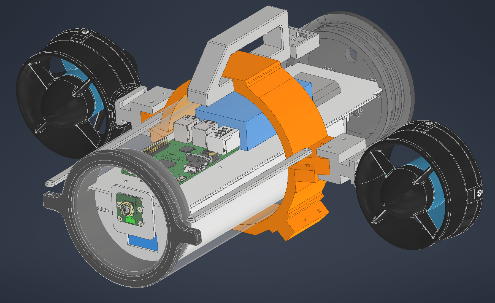
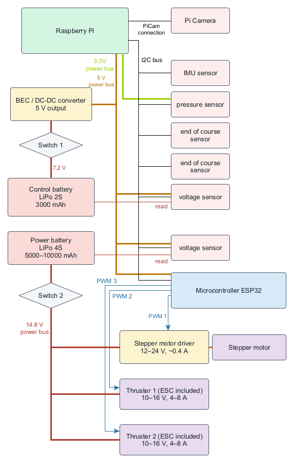

# Underwater Swarm Project

An academic project exploring the design of a small underwater robot platform for swarm applications. This repository currently brings together the vehicle's mechanical and electronics design files, component and cost research, and background literature. The CAD and technical drawings include work-in-progress material.



## Repository map

- [`hardware/CAD_underwater_swarm_project/`](hardware/CAD_underwater_swarm_project/) — vehicle assembly, component CAD, print files, electronics diagram, and technical drawings.
- [`hardware/Electronics/`](hardware/Electronics/) — electronics architecture and related design material.
- [`hardware/Doc/`](hardware/Doc/) — component references, blueprints, and assembly documentation.
- [`hardware/drafts/`](hardware/drafts/) — early hardware and electronics sketches.
- [`hardware/underwater-drone/`](hardware/underwater-drone/) — upstream modular ROV model submodule, including printable parts and its own documentation.
- [`hardware/Underwater_robot_Comparing_designs_synthesis_v2.pdf`](hardware/Underwater_robot_Comparing_designs_synthesis_v2.pdf) — design comparison and synthesis.
- [`hardware/Underwater_Swarm_BOM_TWD_2026.11.16.xlsx`](hardware/Underwater_Swarm_BOM_TWD_2026.11.16.xlsx) — latest dated bill of materials and cost estimate in the repository.
- [`Litterature_review/`](Litterature_review/) — collected papers, proposal, and reference material.
- [`Reports/`](Reports/) — project report archive.

## Design snapshots

| Assembly drawing | Electronics architecture |
| --- | --- |
|  |  |

The assembly drawing is version 1.0 and was rendered from the PDF in the technical drawings folder. The CAD rendering is marked work in progress; consult the source CAD for the current design state. The electronics diagram is an architecture reference.

## Getting the files

Clone the repository and initialize its ROV model submodule to retrieve the upstream model files:

```bash
git clone --recurse-submodules <repository-url>
```

If you already cloned without submodules:

```bash
git submodule update --init --recursive
```

CAD source files are provided in the formats present in their respective folders (including Autodesk Inventor files, STEP/IGES models, and printable files where available). Refer to each folder's documentation for format-specific details. No software build or simulation entry point is currently documented in this repository.
